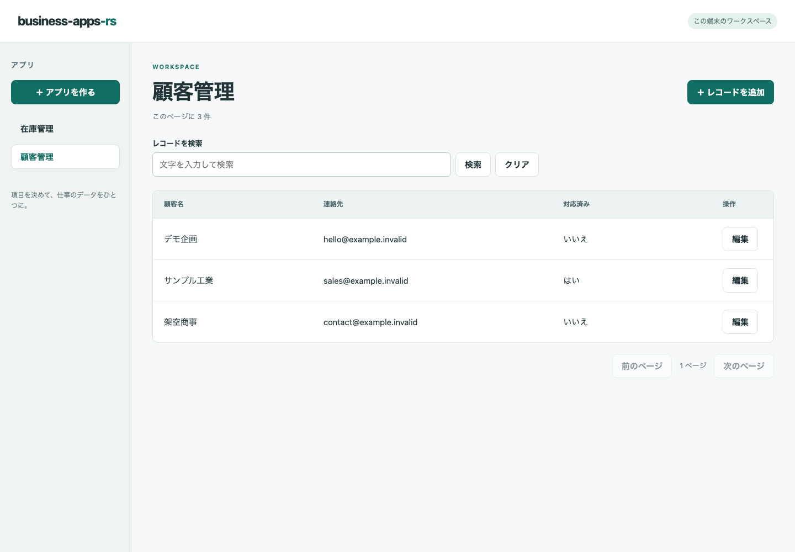

# business-apps-rs

[English](README.md) · [参加ガイド](CONTRIBUTING.md) · [設計手順](docs/development.md) · [今後の段階](docs/roadmap.md)

顧客管理・在庫管理・タスク管理を、項目を選んで作るOSSです。
画面の配置と操作、API、入力ルール、保存処理をRustが担います。
ブラウザ用にはWebAssembly（WASM）へ変換し、CSSと自動生成JavaScriptも配信します。

**現在はローカル開発プレビューです。** チーム利用と公開運用は今後の段階です。
サイボウズとは独立した実装で、kintone API互換には対応していません。



画面は架空のデータです。[画面の役割と編集画面](docs/ui.md)も確認できます。

## できることと今後の段階

| 対象 | ローカルプレビューの範囲 |
| --- | --- |
| 項目 | テキスト・複数行テキスト・数値・チェック・日付・単一選択 |
| レコード | 登録・表示・検索・編集・削除、SQLiteへの保存、更新競合の検出 |
| 出力 | 検索結果を全ページまとめて[CSVに出力](docs/csv.md)。数式対策と件数・容量制限あり |
| フォーム設定 | アプリ名・項目名・順序の変更、任意項目の追加。既存の型・必須設定・選択肢は固定 |
| 未実装・計画中 | チーム認証、役割別権限、監査、ビュー、取り込み、承認フロー、配布・公開運用 |

[ロードマップ](docs/roadmap.md)で段階を分けています。検索は選択中のアプリ内の文字列を走査します。

## 顧客管理を1つ作る

Rust stable（最低1.88）とCコンパイラを用意します。
macOSではXcode Command Line Tools、LinuxではGCCまたはClangを使います。
以下のtargetとCLIの導入は初回だけです。Node.jsはブラウザテストで使います。

```sh
git clone https://github.com/haranishi/business-apps-rs.git
cd business-apps-rs
rustup target add wasm32-unknown-unknown
cargo install wasm-bindgen-cli --version 0.2.129 --locked
cargo xtask dev
```

1. `http://127.0.0.1:8080` を開き、「アプリを作る」で名前を「顧客管理」にします。
2. テキスト項目を2つ用意し、「顧客名」を必須、「連絡先」を任意にして「アプリを作成」を押します。
3. 「レコードを追加」で「架空商事」と `hello@example.invalid` を入力し、「保存」を押します。
4. 「架空商事」を検索し、「編集」から内容を変更して保存します。
5. 「フォーム設定」で項目名や順序を変えたり、任意項目を追加したりします。

サーバーを起動し直しても保存内容を開けます。DBは `.data/business-apps.sqlite` に保存され、Gitには含まれません。
このプレビューは同じ端末からの接続に限ります。認証がないため、架空のデータで試してください。
既存項目は削除できず、キー・型・必須設定・選択肢も変更できません。これらの制約で保存済みの値を保全します。

## Rust UIを含めてビルドする

| コマンド | 処理 |
| --- | --- |
| `cargo xtask dev` | releaseのWASMを生成し、debugサーバーをビルドして起動 |
| `cargo xtask build` | releaseのWASMとreleaseサーバーを生成 |
| `cargo xtask build-web` | サーバーをビルドせず、ブラウザ用の生成物を更新 |

サーバーは画面の生成物を1つの実行ファイルに埋め込みます。
生成後は `cargo run -p business-apps-server` でも起動できます。
[Rust UIの開発手順](docs/rust-ui.md)で、`crates/ui`、生成先の `web/pkg`、CSS、再ビルドを説明しています。
Python 3.10以上は文書と性能測定、Node.js 22以上はPlaywrightによるブラウザテストで使います。

## 設計を読み、変更を提案する

| やりたいこと | 入口 |
| --- | --- |
| 機能と受け入れ条件を設計する | [設計手順](docs/development.md) |
| 実行時の構成とデータの境界を知る | [設計書](docs/design.md)・[API v1](docs/api.md) |
| 画面と操作の流れを知る | [UI設計と図解](docs/ui.md) |
| 初めて貢献する | [CONTRIBUTING](CONTRIBUTING.md) |
| Rust・WASM・ブラウザの検証を行う | [テスト手順](docs/testing.md)・[開発ハーネス](HARNESS.md) |
| 速度を評価する | [条件と実測値](docs/performance.md) |

再現報告、文書、翻訳、操作しやすさの改善、テスト、小さな修正を歓迎します。
新しいAPI、保存形式、大きな依存追加、チーム・ネットワーク機能は、実装前にIssueで相談します。
速度を主張するときは、処理内容・ビルド・機器・試行数・実測値を示します。Rustを使うだけでは速さの根拠になりません。
CIの設定と実行結果は区別し、対象コミットと実行記録で確認します。

## ライセンスとデータ

オリジナルのコード・文書・図・画面画像は[Apache-2.0](LICENSE)です。依存物にはそれぞれのライセンスがあります。
[NOTICE](NOTICE)、[依存物と出典の方針](docs/licenses.md)、[脆弱性の非公開報告](SECURITY.md)も確認してください。
貢献には実業務のDB・認証情報・個人の設定を含めず、架空の例を使います。
kintoneはサイボウズ株式会社の登録商標です。本プロジェクトは同社の提携・推奨を受けたものではありません。
