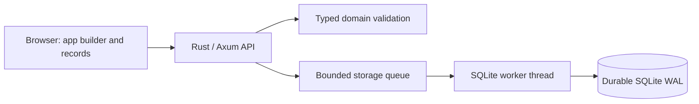

# business-apps-rs

[日本語](README.ja.md) · [Contribute](CONTRIBUTING.md) · [Design](docs/design.md) · [Roadmap](docs/roadmap.md)

Create a business app from typed fields, then manage its records in a browser.
An independent Rust OSS project for local customer lists, inventory, and task trackers.

**Status: local development preview.** App schemas are immutable; team authentication, permissions, and workflows are planned.
This is an original implementation, independent of Cybozu and kintone. It does not implement kintone API compatibility.

## Try your first app

Install Rust stable (minimum 1.88) and a C toolchain (Xcode Command Line Tools on macOS; GCC/Clang on Linux).

```sh
git clone https://github.com/haranishi/business-apps-rs.git
cd business-apps-rs
cargo run -p business-apps-server
```

Open `http://127.0.0.1:8080`. Choose an app name and text, multiline, number, checkbox, date, or select fields, then add a record.
Search your entries, edit them, or reopen the app to read the saved data.
The preview only accepts loopback listeners and has no user/permission model; use synthetic data.
SQLite data lives in `.data/business-apps.sqlite`, outside Git.

## How it fits together



The browser assets are embedded in one server binary. Running it requires no Node or frontend build.
The domain layer stays independent of transport and storage; revision checks prevent stale edits from overwriting new changes.
Record listing uses an app-scoped cursor index. Text search is a per-app scan of string values.
Performance claims require the reproducible [benchmark and measured baseline](docs/performance.md), rather than assumptions about Rust.

## Read the design or join in

| You want to… | Start with |
| --- | --- |
| Understand the boundaries and design process | [Design principles and structure](docs/design.md) |
| See the screens and operation flow | [UI diagram and user stories](docs/ui.md) |
| Call the API | [API v1 and examples](docs/api.md) |
| Make a first contribution | [Contribution guide](CONTRIBUTING.md) |
| Run tests, CI, or a benchmark | [Test environments](docs/testing.md) |
| Work with a coding agent | [Harness](HARNESS.md) and [repository skill](.agents/skills/business-apps/SKILL.md) |
| Understand licensing and source provenance | [Licensing](docs/licenses.md) |

Bug reproduction, documentation, translation, accessibility, and focused code fixes are welcome.
There is no contributor registration requirement. Discuss new APIs, migrations, and major dependencies in an Issue first.

## Verify your change

Development checks need Node.js 22+, Python 3.10+, and Rust stable.

```sh
scripts/check.sh
npm ci
npx playwright install chromium
npm run test:e2e
cargo deny check licenses bans sources
```

CI covers Rust on Linux/macOS, the minimum Rust version, dependency licenses, and browser flows at three widths.
A CI configuration is not a verified run; current PR checks show the evidence for each revision.

## License

Original code, docs, and diagrams use [Apache-2.0](LICENSE); dependencies retain their own licenses.
See [NOTICE](NOTICE), [licensing details](docs/licenses.md), and [security reporting](SECURITY.md).
kintone is a registered trademark of Cybozu, Inc.; this project has no affiliation or endorsement.
