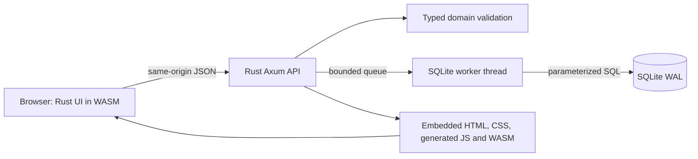
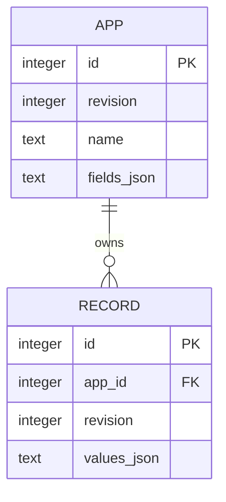

# Design: Rust application logic, durable local data

An app is a schema owned by its creator; a record is one typed entry in that app.
The first use case is a local customer list, inventory, or task tracker.
Follow [the development steps](development.md) when proposing a change.

## Principles and tradeoffs

- **Preserve saved work.** Validate at the server boundary and compare revisions before writes.
- **Use Rust across application logic.** Browser layout/events, API, domain rules, and storage use Rust.
- **Keep browser delivery explicit.** WASM uses generated JavaScript glue and CSS; the server embeds the built assets.
- **Keep rules independent.** Domain rules do not depend on HTTP, DOM, or SQLite.
- **Measure speed.** Workload and tail latency justify optimization; the language alone does not.

The UI uses direct `wasm-bindgen`/`web-sys` DOM bindings to retain native controls and the existing screen flow.
This keeps the current UI small, while requiring explicit management of events, focus, pending requests, and stale responses.
A frontend framework or plugin system needs its own user benefit and maintenance case before adoption.

## Runtime boundaries

`crates/ui` owns layout, view state, and interactions; `web/style.css` owns styling.
Generated `web/pkg` files are build outputs. [Rust UI builds](rust-ui.md) explain how they enter the server binary.
Browser-side checks provide feedback; server/domain validation is authoritative for persisted data.
SQLite work runs on its dedicated worker rather than a Tokio runtime thread.
The bounded queue serializes database operations in this preview.
Listing uses an app-scoped cursor index; text search scans string values within an app.

## Data and compatibility

Apps and records compare their own revisions when saving; SQLite enforces the app foreign key.
Stable field keys preserve values when names or order change.
Only safe label/name/order changes and optional field additions are accepted; existing types, required flags, choices, and fields stay intact.
See [schema-editing rules](schema-editing.md) for these invariants and upgrade behavior.

The Rust UI transition retains API v1 and SQLite format 3; it does not require a data-format migration.
A browser implementation change still needs the existing create/save/search/edit/reopen and conflict flows to remain usable.
Changing API or saved-data contracts requires an explicit compatibility decision and the corresponding tests.

## Where to design the next change

[Development steps](development.md) turn a user task into acceptance criteria, boundary decisions, and evidence.
[UI stories](ui.md), [API v1](api.md), and the [roadmap](roadmap.md) define the relevant public contracts.
Preserve input drafts, existing records, app isolation, and revision checks while adding the smallest useful behavior.
