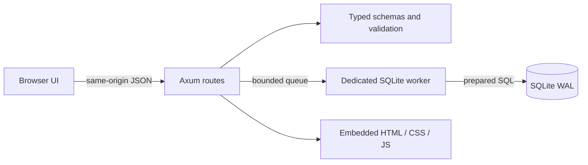
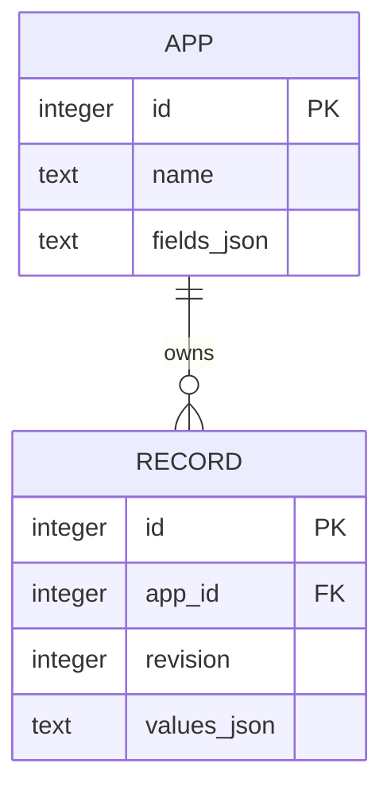

# Design: small core, durable data, measured speed

An app is a schema owned by its creator; a record is one typed entry in that app.
The first use case is a small local customer, inventory, or task tracker.

## Principles

- **Data integrity first.** Validate types at the boundary and use optimistic revisions to prevent lost updates.
- **Small deployment.** Ship one Rust process with embedded static assets and SQLite; no frontend build is required to run it.
- **Explicit boundaries.** Domain rules know neither HTTP nor storage. Transport translates errors; storage controls persistence.
- **Measure before optimizing.** State the workload and tail latency. Rust alone does not prove that an application is fast.
- **Readable contributions.** Favor ordinary Rust and a small number of modules over a plugin framework or custom language.

## Runtime structure

`domain` depends only on Serde. `server` depends on `domain`, Axum, Tokio, and rusqlite.
The SQLite connection lives on one dedicated OS thread, so database work cannot block async HTTP tasks.
The queue has a fixed capacity; database operations are serialized in this preview.
An index on `(app_id, id DESC)` supports app-scoped cursor pagination without OFFSET.
Text search scans string values within an app; it is not a full-text index.

## Data model

Schema creation and record validation occur in Rust; SQLite enforces the app foreign key.
Updates and deletes compare the submitted revision inside the database operation.
The schema is immutable in this milestone to avoid unsafe changes to saved values.

## Adding a feature

1. Give an example of the user's task and the expected result.
2. Decide which contract changes: typed values, API, saved data, or browser operation.
3. Implement the smallest vertical slice and its failure-case tests.
4. Update the relevant diagram/API example, run checks, and open a focused PR.

Read [the UI contract](ui.md), [HTTP API](api.md), and [roadmap](roadmap.md) for the next boundaries.
