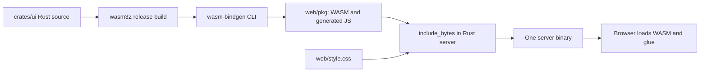

# Build and change the Rust browser UI

Browser layout, state, and event handling live in `crates/ui` and compile to WebAssembly (WASM).
The UI uses `wasm-bindgen` and `web-sys` directly with native DOM controls.
API/domain/storage remain Rust; API v1 and SQLite format 3 are unchanged by the UI transition.

## Install the build tools once

Use Rust stable (minimum 1.88) and a C toolchain: Xcode Command Line Tools on macOS or GCC/Clang on Linux.

```sh
rustup target add wasm32-unknown-unknown
cargo install wasm-bindgen-cli --version 0.2.129 --locked
```

Keep the CLI at the version matched by the locked Rust dependency. A CLI/schema mismatch requires matching versions and regeneration.
`BIZAPP_WASM_BINDGEN` selects a CLI outside PATH; the build respects Cargo's configured target directory.
Node.js 22+ is used only for Playwright tests. Python 3.10+ supports documentation and benchmark tooling.

## Choose the build you need

| Command from the repository root | Builds and runs |
| --- | --- |
| `cargo xtask build-web` | Release WASM plus generated browser glue in `web/pkg` |
| `cargo xtask dev` | Browser assets, then the debug server; starts the local preview |
| `cargo xtask build` | Browser assets, then the release server binary |
| `cargo run -p business-apps-server` | Debug server using browser assets that have already been generated |

A fresh checkout needs `build-web` or an xtask command that includes it before direct server compilation.
After changing UI Rust, rebuild browser assets before rebuilding/restarting the server.
The server embeds assets at compile time; a stale binary cannot serve a newly generated UI.

## Follow the source-to-browser path



`crates/ui` is the source of application layout and behavior; `web/style.css` remains authored CSS.
`web/pkg/*` contains generated assets and is ignored by Git. Commit source, dependency locks, and reproducible build instructions.
Generated JavaScript performs browser/WASM initialization and binding; Playwright tests and CI configuration also remain outside Rust application logic.
The delivered application therefore includes CSS and generated JavaScript as well as WASM and native Rust.

## Preserve the operation contracts

Keep native date/select/textarea controls, Japanese labels, dialog focus, and responsive behavior while changing the Rust UI.
Preserve drafts after validation/conflicts, lock writes in progress, and ignore responses belonging to an obsolete UI operation.
An older form must retain saved fields that its current schema does not display.
Server/domain validation and revision checks remain authoritative even when the browser validates input.
[UI stories](ui.md), [schema rules](schema-editing.md), and [testing](testing.md) define the checks.

## Verify the generated UI

Run `scripts/check.sh` after setup to build assets and check native Rust, WASM, and docs.
Run the relevant Playwright flows after `npm ci` and `npx playwright install chromium`.
Check browser loading and interaction behavior; a native server build alone does not prove that its embedded UI works.
Record the exact revision and results. Screenshots illustrate the layout and do not establish a successful test run.
