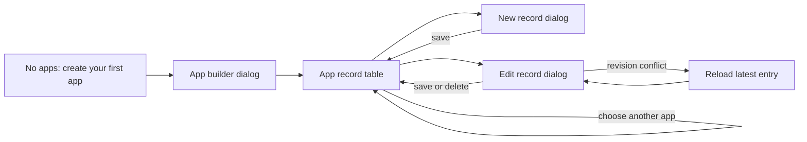
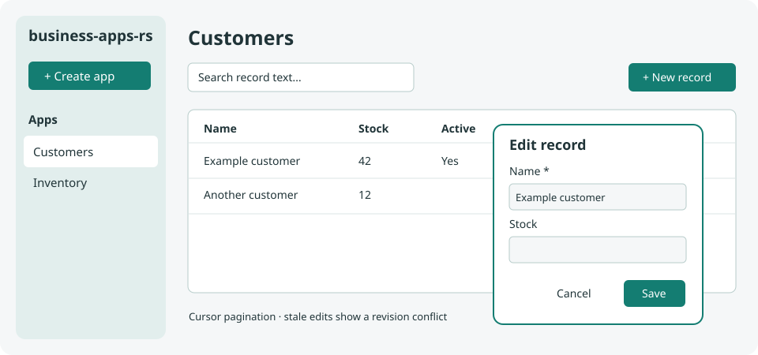

# UI: build an app, then manage its records

## User stories

| Person | Task | Reason | Acceptance |
| --- | --- | --- | --- |
| Small-team operator | Create an app from named fields | Replace a scattered spreadsheet | Define text/number/checkbox fields without coding |
| Record editor | Save and find an entry | Keep work up to date | Required input errors preserve the draft |
| Record editor | Edit an entry already opened | Avoid overwriting another change | Stale revisions show a conflict and offer reload |
| Contributor | Understand a screen's responsibility | Make a focused improvement | Screen actions map to documented API operations |

## Five UX layers

| Layer | Decision |
| --- | --- |
| Strategy | Make a first working tracker possible in one short session |
| Requirements | App creation, typed records, search, editing, deletion, and saved data |
| Structure | App list → record table → record dialog; app builder opens from the list |
| Skeleton | App navigation on the left; search and primary action above the table |
| Surface | Neutral background, teal primary actions, visible labels/focus, restrained motion |

The preview is local and stores business records. Public sharing and social buttons are outside this screen's purpose.
The browser UI currently uses Japanese labels; translating them is a welcome contribution.

## Screen flow

## Layout

At 390 px, navigation becomes a horizontal app picker and the table scrolls within its container.
Dialogs keep their own scrolling area; cancel returns focus to the invoking button.
User text is rendered with `textContent`; it never becomes executable HTML.

## Interaction checks

- Start from an empty database, create an app, and save one record.
- Fail a required value, keep the draft, correct it, and save.
- Search, edit, cancel, and delete with explicit confirmation.
- Open two editors and verify that a stale save cannot replace newer data.
- Use only the keyboard, then inspect 390/768/1440 px widths.

Browser regression tests live in `tests/ui.spec.js`; API/storage cases live in `crates/server/tests`.
