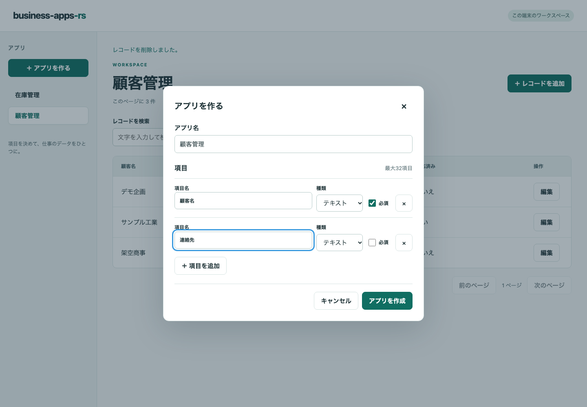
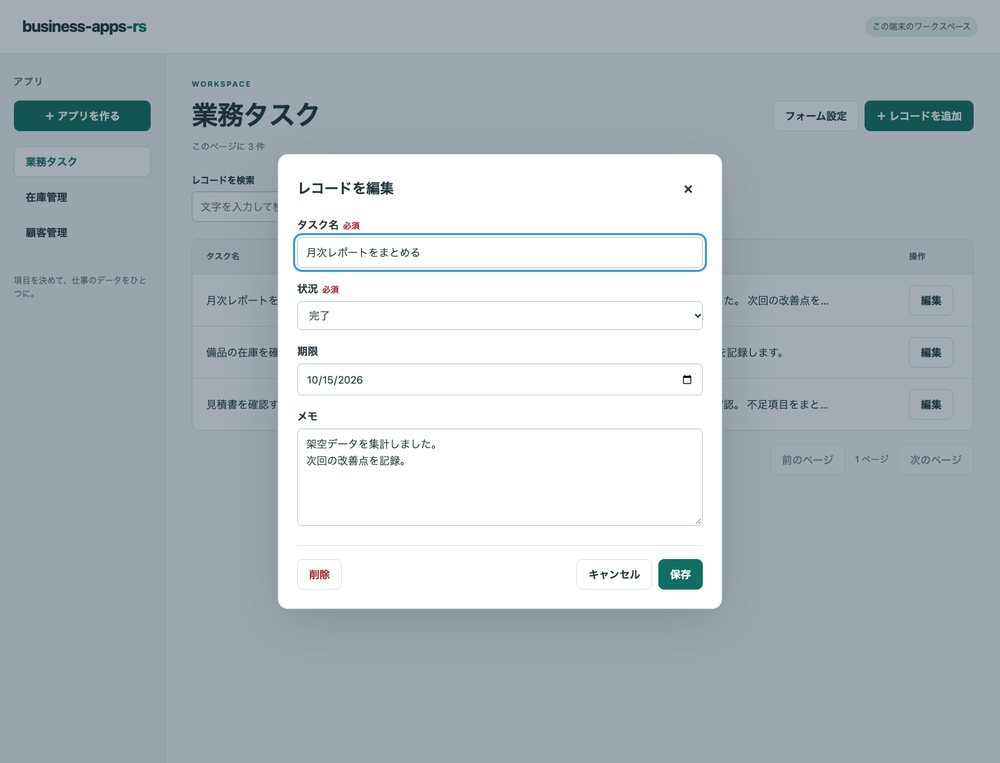
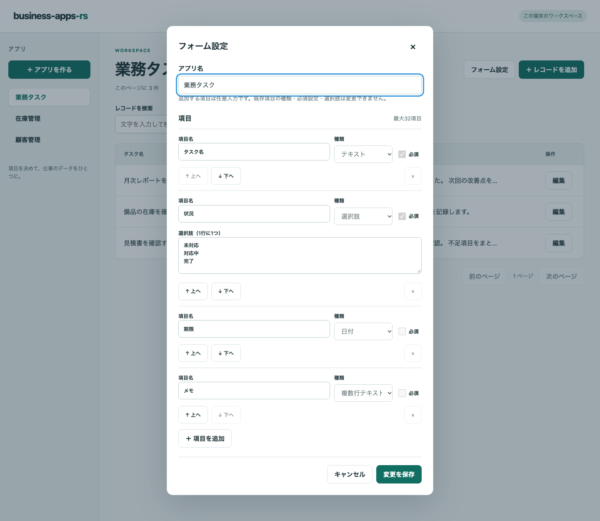
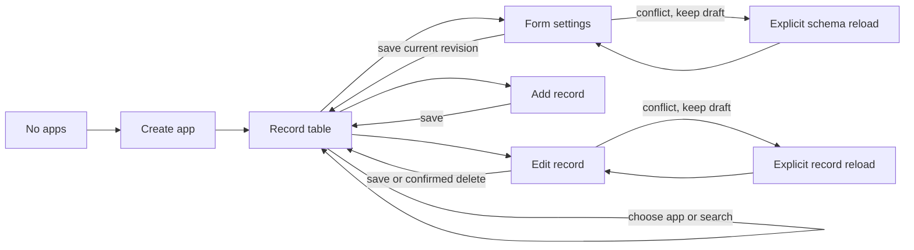

# UI: build an app, then manage its records

The Rust UI in `crates/ui` owns browser layout and interactions; CSS is in `web/style.css`.
[Build the UI](rust-ui.md) or follow [the design steps](development.md) before changing a flow.

## User stories and acceptance

| Person | Task | Acceptance |
| --- | --- | --- |
| Small-team operator | Create a tracker without coding | Choose text, multiline, number, checkbox, date, or single-choice fields |
| Record editor | Save and find an entry | Required errors preserve the draft; saved values reopen correctly |
| App owner | Take records into a spreadsheet | CSV includes all matching pages; errors allow retry without losing the workspace |
| Record editor | Find work by a typed field | One exact/empty condition combines with text search, pages, and CSV |
| Record editor | Edit an already-open entry | Stale saves preserve input and offer explicit reload |
| App owner | Rename, reorder, or add a field | Old values stay intact; additions are optional; conflicting settings keep the draft |

## Five UX layers

| Layer | Decision |
| --- | --- |
| Strategy | Make one working tracker possible in a short session |
| Requirements | App creation, typed records, search, settings, and persisted edits |
| Structure | App list → table → record dialog; settings reuse the builder |
| Skeleton | App navigation beside the table; search and actions above it |
| Surface | Neutral background, teal actions, native controls, visible labels and focus |

This local preview stores business records; public sharing is outside its purpose.
The interface uses Japanese labels. English or Japanese contributions can improve their clarity and accessibility.

## Screens and their responsibilities

| Screen | Main job |
| --- | --- |
| App list and table | Choose an app, search records, open settings, add or edit a record |
| Builder | Name fields, choose types, and enter select choices one per line |
| Record editor | Enter native date/select values and plain multiline text; save or cancel |
| Form settings | Rename/reorder/add optional fields while preserving existing values |

The following captures use synthetic task data; they illustrate the workflows and are not proof of a particular build passing tests.

## Operation and recovery

## Interaction constraints

- At 390 px, app navigation adapts above the table; the table scrolls within its container.
- Short table strings stay on one line; long values are visually shortened and remain available in the editor.
- Dialogs scroll internally. Cancel/Escape returns focus to the invoking button.
- Pending writes lock every dialog control, cancel, and Escape; the save action shows its pending state.
- Settings lock existing keys, types, required flags, choices, and removal. New fields are optional.
- Up/down actions reorder without dragging and return focus to the moved field.
- Stale settings/records preserve drafts until explicit reload; reload explains that input will be replaced.
- Render user content as plain text. Native date formatting follows the browser locale; textarea keeps line breaks.
- CSV uses the last submitted search, including all pages; unsubmitted text never changes paging/export.
- CSV shows pending/success/error feedback, locks duplicate downloads, and discards responses after a table reload.
- [Field filters](record-filters.md) apply explicitly; a visible summary distinguishes fetched results from control drafts.
- Late responses must not replace a newer app selection or editing draft; old-form edits must preserve unknown saved fields.

[Rich-field contracts](../.agent-harness/contracts/rich-fields.md) and [schema-editing contracts](../.agent-harness/contracts/schema-editing.md) record the feature decisions.
[Testing](testing.md) covers create → save → search → edit → reopen, validation, conflicts, focus, pending locks, and three widths.
